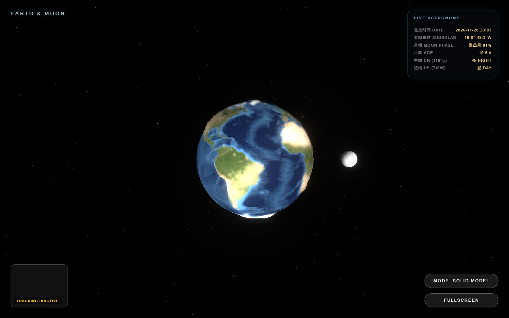
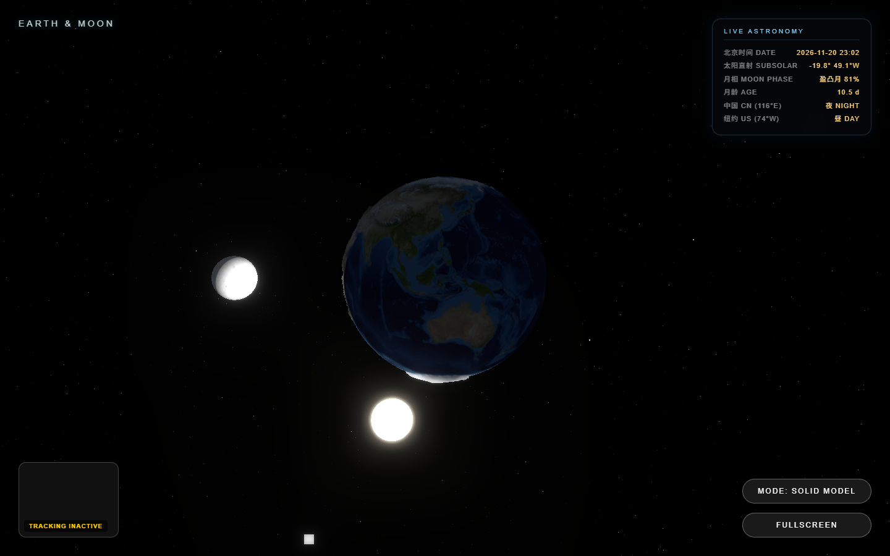
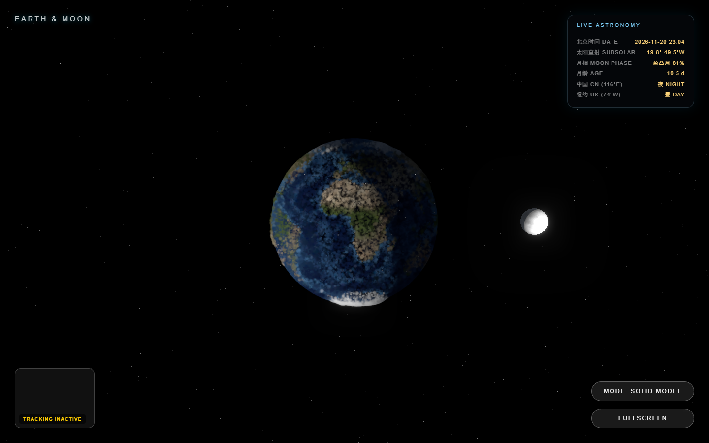

# EARTH & MOON · 真实天文地月交互站

一个基于 **Three.js + MediaPipe Hands** 的交互式地月系统。本仓库是对 [maoawa/earth-moon](https://github.com/maoawa/earth-moon) 的**二次开发**，在原项目基础上加入了真实天文晨昏线、月相计算、城市标记、手势滤波等增强功能。

核心亮点：**按当前真实时刻计算太阳直射点，并把晨昏线真实投影到地球表面**——此刻中国是昼是夜，模型上就是昼是夜。

## 致谢与原作者

- **原作者：Mars（GitHub: [@maoawa](https://github.com/maoawa)）** — 原项目 [maoawa/earth-moon](https://github.com/maoawa/earth-moon)，原始站点 [earth.maao.cc](https://earth.maao.cc)。原 README 记载该项目借助 Gemini 创建，采用 MIT 开源协议（见 [LICENSE](LICENSE)）。
- **二次开发：shark-syh** — 本仓库在此基础上新增了下述「二次开发新增功能」。

## 截图

> 以下均为本项目实际运行渲染截图（Chrome headless + WebGL 软件渲染）。

### 真实晨昏线 · 昼夜各半


太阳直射点在南半球时，南极圈内极昼、北极圈内极夜，晨昏线倾斜。画面中地球左亮右暗的分界即为**由当前时刻真实算出的晨昏圈**——不是贴图或固定光照。右上角 HUD 显示北京（夜）与纽约（昼）的实时状态。

### 实体地球 · 夜半球视角


高分辨率蓝色大理石贴图 + 地形高度图凹凸。放大后可看到主要城市的**高亮打点与中文名称**（转到背面自动隐藏）。

### 粒子地球


25 万粒子构成的点云地球，按同样的真实晨昏线逻辑着色，放大时呈现混沌的粒子扩散效果。

## 二次开发新增功能

- **真实天文引擎**
  - 由当前日期计算太阳赤纬（Meeus 低精度算法，含黄赤交角）
  - 由当前 UTC 时刻计算太阳直射经度（15°/小时 + 均时差 EoT 修正）
  - 地表每点太阳高度角 `sin(h) = sinφ·sinδ + cosφ·cosδ·cos(λ−λ☉)`
  - 晨昏线 = `sin(h)=0` 等值线，写成 GLSL shader，**与模型旋转无关**，每 30 秒随真实时间刷新
- **实时天文 HUD**：北京时间、太阳直射点经纬度、月相名称 + 照度、月龄、中国/纽约昼夜状态
- **真实月相**：相位角由当前时刻与朔望月（29.53 天）计算，锁定真实时间；月球 shader 带清晰晨昏线与地球反照（earthshine），潮汐锁定同一面朝地球
- **城市标记**：27 个主要城市的高亮点与中文名，放大到阈值后显示，背面自动隐藏
- **手势滤波**：One Euro Filter 平滑手部关键点，静止不抖、快速移动跟手
- **缩放手感优化**：相机距离与缩放联动，放大更明显且不穿模

## 继承自原项目的功能

- Three.js 0.160 场景、UnrealBloomPass 泛光后期、深空星空
- 实体地形球 / 25 万粒子点云双模式切换
- MediaPipe Hands 手势识别：手掌左右移动旋转地球、张手/握拳缩放
- 极简 UI、毛玻璃面板、全屏按钮
- GitHub Pages 部署（CNAME）

## 技术栈

- [Three.js 0.160](https://threejs.org/)（ES Module + importmap，unpkg CDN）
- [MediaPipe Hands](https://developers.google.com/mediapipe)（浏览器端手部关键点检测）
- EffectComposer / UnrealBloomPass 泛光后期
- 单文件 `index.html`，无需构建工具
- 贴图来自 `three-globe` 与 `three.js` 示例资源（jsDelivr / GitHub CDN）

## 运行

直接用浏览器打开 `index.html`，或起一个本地静态服务器：

```bash
python -m http.server 8000
# 访问 http://localhost:8000
```

首次加载会请求摄像头权限——**允许**后即可用手势控制；拒绝权限也不影响 3D 场景与晨昏线的自动展示（约 2.5 秒后加载遮罩自动消失）。

> 需要支持 WebGL 的现代浏览器。摄像头手势功能需要 `localhost` 或 HTTPS 环境。

## 手势速查

| 手势 | 效果 |
| --- | --- |
| 手掌左右平移 | 旋转地球（换视角） |
| 张开五指 / 握拳 | 放大 / 缩小 |

## 部署

仓库根目录含 `CNAME`，可直接作为 GitHub Pages 站点发布。在仓库 Settings → Pages 中选择 `master` 分支根目录即可。

## 目录

```
.
├── index.html          # 全部源码（单文件应用）
├── CNAME               # GitHub Pages 自定义域名
├── LICENSE             # MIT（Copyright © 2026 Mars）
├── README.md
└── screenshots/        # 运行截图
    ├── 01-terminator.png
    ├── 02-solid-earth.png
    └── 03-particle-mode.png
```

## 许可

MIT © 2026 Mars（原作者）。二次开发部分遵循同一协议。
